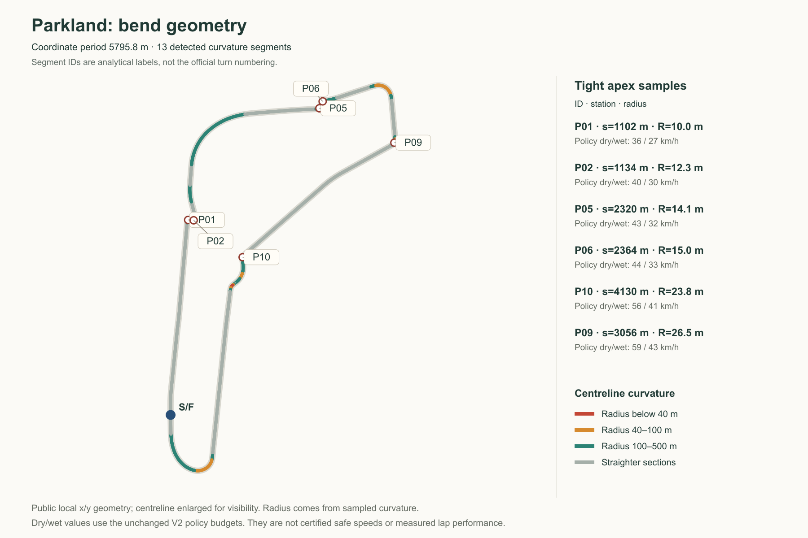
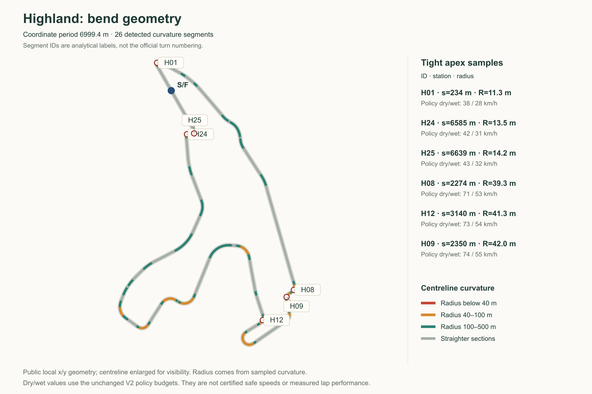
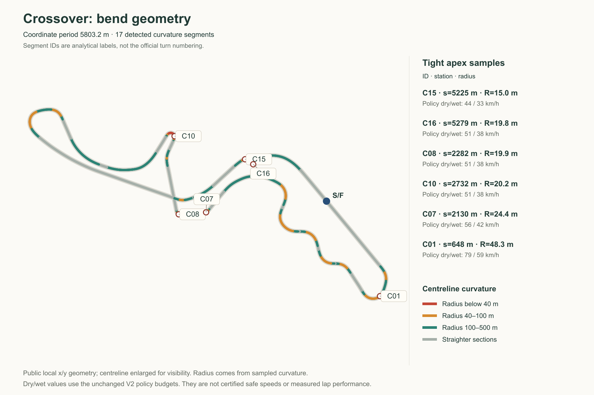

# 三赛道弯道与油门分析

日期：2026-11-17。数据源：仓库三份公开 mapdata JSON，以及 Formula/13–18 的 6 场真实 V2 日志。
V3 主版按用户要求只修交通；下面的补油逻辑仅加入独立的 V3 弯道试验版。

## 1. 结论：有条件补油，不给所有弯道统一加油门

原车手没有“转弯一律松油”的规则：目标速度高于当前车速时，在弯道也会给油。实测弯段中，油门经常已经非零；因此不能通过设置固定最低油门来判断或解决速度问题。

本次试验选择的是：车辆稳定、低于原目标速度、没有跟车限速、前方弯道不再收紧，并且横向预算有余量时，增加少量用于抵消空气阻力和滚动阻力的油门。弯心速度预算保持原样；这可能减少低于目标速度的滞后，但不等于已经提高实际圈速。

## 2. 地图几何概览

|赛道|坐标周期 m|识别弯段|显著曲率路段占比|最窄左右半宽 m|最大绝对坡度|
|---|---:|---:|---:|---|---:|
|Parkland|5795.8|13|27.8%|6.0 / 6.0|9.2%|
|Highland|6999.4|26|38.6%|6.0 / 6.0|16.7%|
|Crossover|5803.2|17|53.2%|5.0 / 5.0|11.4%|

按 |curvature|≥0.002 1/m（半径≤500 m）识别显著曲率路段，同方向相邻段间隔不超过 40 m 时合并。编号 P/H/C 是分析编号，不是官方弯道编号；因此这里的 13、26、17 不能与官方弯道数直接等同。

所有里程使用地图 length_m 的坐标周期。源数据中的 official_length_m 和部分扇区末端标签与实际坐标周期不同；本报告不把那些标注值当作 s 的环绕周期。局部曲率来自离散编译中心线，尖峰半径也不是车辆实际行车线半径。

### Parkland



直线占比较大，最紧的连续变向集中在约 1086–1168 m 和 2302–2382 m。适合优先处理“在直路被慢车挡住”的问题。急弯仍应完成减速后再恢复动力；重点观察约 1108、1146、2326、2368 m 之后曲率开始回落的路段，是否在原目标以下且车辆已稳定，而不是在这些里程点固定给油。

### Highland



弯段更多，公开几何中坡度变化最大。约 208–258 m、6561–6671 m 的局部弯心较紧，末段还靠近维修区入口。可关注弯道放缓后的加速衔接，但坡顶、下坡制动和轮载变化不能由简化曲率公式完全表示。试验版未加入额外的坡度重力补偿，避免把前方 15 m 处的坡度直接当作当前动力需求。

### Crossover



显著曲率路段占比最高，连续变向多，且最窄半宽只有约 5 m。约 2260–2312 m、2712–2800 m、5161–5303 m 有较紧弯段。补油更适合曲率放缓且后续没有立即反向收紧的位置；连续 S 弯里过早给油，可能增加下一次制动和修正。本图为二维投影，立交处的交叉不表示车辆必然同层相撞。

## 3. 真实日志中的弯道油门

下表合计使用 148,143 次 V2 决策作为源数据，排除维修区状态，以当前地图曲率判断是否在弯段；油门/刹车超过 0.02 记为使用，否则两者均不超过 0.02 时记为滑行。

|赛道|阶段|弯段观测时长 s|已有油门占比|刹车占比|滑行占比|符合试验补油条件 s|触发时平均新增油门|
|---|---|---:|---:|---:|---:|---:|---:|
|Parkland|排位|290.6|74.2%|14.8%|11.0%|27.0|6.3 个百分点|
|Parkland|正赛|825.6|73.7%|11.3%|14.9%|42.2|3.3 个百分点|
|Highland|排位|105.6|61.2%|27.9%|10.9%|15.7|3.9 个百分点|
|Highland|正赛|387.3|59.7%|28.8%|11.5%|59.5|4.1 个百分点|
|Crossover|排位|139.5|67.1%|20.9%|12.0%|22.8|1.8 个百分点|
|Crossover|正赛|409.5|66.2%|21.0%|12.8%|63.1|2.1 个百分点|

这些是同一车手历史观测下的动作占比和试验门限扫描，样本覆盖 4 场 Parkland、1 场 Highland、1 场 Crossover，天气并不相同。符合补油条件的秒数不代表可节省的秒数；平均新增量是门限触发时的数值，不代表全程油门都增加这么多。

## 4. 独立试验版怎样补油

使用当前合法遥测中的 drag_n、rolling_resistance_n 与当前 ERS 模式对应的 drive_force_n：

```text
补偿比例 ≈ (空气阻力 + 滚动阻力) / 当前模式可用驱动力
新增油门 = min(0.15, 补偿比例) × clip(目标速度 - 当前速度, 0, 1)
```

这是小幅前馈支持假设，不是完整动力学识别或标定模型。单次增加最多 15 个油门百分点；历史门限扫描中通常是约 2–6 个百分点。车辆设计、55 m/s 目标上限、横向预算 10×grip、制动预算 7×grip 均未修改。

同时要求：

- 处于恒定或放缓的弯道；前 3 个预览点不显示明显进一步收紧或反向。
- 当前速度低于原目标速度，没有刹车，交通模块也没有把目标压低。
- 朝向误差小于 0.10 rad，实际横向位置距目标小于 0.75 m，没有前/后轮滑动。
- 实测横向 g 和前方曲率估计的横向需求，都小于原横向预算的 90%。
- 离开最初 6 秒，不在维修区，燃油不少于 5 kg；所需遥测存在且为有限数。

任一条件不满足即保留 V3 主版动作；越接近原目标，补油越淡出。在刹车、拥堵、接近横向预算或失稳时不强行加油。额外油门上限和 90% 预算门槛都是试验控制选择，不是官方物理常数。

## 5. 全部识别弯段

参考速度仅用于解释当前 V2/V3 预算：干地 sqrt(10×R)、全湿 sqrt(5.5×R)，均限于 55 m/s，再换成 km/h。假定零磨损、中心线，不计偏移、温度、坡度、联合抓地和制动距离；不应直接当作实赛安全速度或照表设置油门。
“回落观察点”是峰后曲率首次回落至峰值 80% 的位置，仅用于复盘定位，试验版并没有硬编码这些里程点。

### Parkland 弯段表

|编号|s 范围 m|曲率峰 s m|峰值半径 m|预算参考干/湿 km/h|回落观察点 s m|
|---|---|---:|---:|---|---:|
|P01|1086→1120|1102|10.0|36 / 27|1108|
|P02|1120→1168|1134|12.3|40 / 30|1146|
|P03|1246→1338|1296|265.0|185 / 137|1324|
|P04|1456→1900|1510|258.0|183 / 136|1540|
|P05|2302→2342|2320|14.1|43 / 32|2326|
|P06|2344→2382|2364|15.0|44 / 33|2368|
|P07|2394→2446|2426|377.3|198 / 164|2444|
|P08|2650→2816|2704|69.0|95 / 70|2782|
|P09|3024→3086|3056|26.5|59 / 43|3066|
|P10|4106→4152|4130|23.8|56 / 41|4136|
|P11|4160→4294|4236|96.4|112 / 83|4270|
|P12|4300→4348|4318|31.1|63 / 47|4326|
|P13|5276→5688|5324|73.7|98 / 72|5420|

### Highland 弯段表

|编号|s 范围 m|曲率峰 s m|峰值半径 m|预算参考干/湿 km/h|回落观察点 s m|
|---|---|---:|---:|---|---:|
|H01|208→258|234|11.3|38 / 28|242|
|H02|436→472|454|449.7|198 / 179|—|
|H03|554→586|566|423.3|198 / 174|—|
|H04|866→930|900|142.1|136 / 101|914|
|H05|944→1080|986|106.3|117 / 87|1012|
|H06|1094→1168|1128|115.2|122 / 91|1142|
|H07|1398→1488|1458|246.4|179 / 133|1476|
|H08|2216→2304|2274|39.3|71 / 53|2288|
|H09|2308→2400|2350|42.0|74 / 55|2364|
|H10|2448→2554|2502|44.6|76 / 56|2516|
|H11|2812→3004|2958|43.6|75 / 56|2974|
|H12|3094→3192|3140|41.3|73 / 54|3160|
|H13|3338→3368|3352|399.1|198 / 169|—|
|H14|3602→3992|3712|88.8|107 / 80|3732|
|H15|4276→4434|4386|71.3|96 / 71|4412|
|H16|4442→4584|4482|69.1|95 / 70|4550|
|H17|4734→4856|4808|45.9|77 / 57|4824|
|H18|4936→5096|5016|93.4|110 / 82|5062|
|H19|5142→5274|5170|263.8|185 / 137|5186|
|H20|5384→5460|5414|295.8|196 / 145|5442|
|H21|5649→5829|5769|249.8|180 / 133|5807|
|H22|5973→6095|6027|118.3|124 / 92|6065|
|H23|6289→6353|6311|390.0|198 / 167|6349|
|H24|6561→6607|6585|13.5|42 / 31|6593|
|H25|6609→6671|6639|14.2|43 / 32|6651|
|H26|6673→6689|6677|236.6|175 / 130|6681|

### Crossover 弯段表

|编号|s 范围 m|曲率峰 s m|峰值半径 m|预算参考干/湿 km/h|回落观察点 s m|
|---|---|---:|---:|---|---:|
|C01|470→770|648|48.3|79 / 59|676|
|C02|890→990|948|66.9|93 / 69|966|
|C03|998→1124|1048|66.2|93 / 69|1080|
|C04|1148→1286|1212|75.3|99 / 73|1256|
|C05|1298→1488|1428|69.3|95 / 70|1452|
|C06|1510→1978|1600|77.7|100 / 74|1632|
|C07|2108→2150|2130|24.4|56 / 42|2136|
|C08|2260→2312|2282|19.9|51 / 38|2296|
|C09|2562→2654|2608|96.6|112 / 83|2626|
|C10|2712→2800|2732|20.2|51 / 38|2778|
|C11|2908→3210|3026|123.0|126 / 94|3046|
|C12|3260→3474|3428|238.0|176 / 130|3454|
|C13|3591→3937|3787|49.9|80 / 60|3815|
|C14|4761→4993|4801|87.7|107 / 79|4821|
|C15|5161→5245|5225|15.0|44 / 33|5231|
|C16|5251→5303|5279|19.8|51 / 38|5291|
|C17|5307→5579|5365|98.4|113 / 84|5389|

## 6. 下一步如何判断是否该提高弯心速度

先用只修交通的 V3 主版取得新日志，再对照弯道试验版，按赛道、湿度与轮胎分组，比较无交通干扰弯段的速度跟踪、制动次数、滑动、越界和圈速。如果试验版只增加轮滑或修正，没有改善速度跟踪，就应回退补油。真正提高弯心目标速度，需要另外研究横向预算与车辆设计；不能由本次静态地图直接得出“所有弯都能更快”的结论。

复现：在仓库根目录运行 `python3 tools/analyze_corners.py /Users/syeah/Downloads/Formula --output analysis/v3-corners`。完整数值目录见 corner-catalogue.csv；分天气/阶段的证据见 analysis/v3-corners/corners.json。
