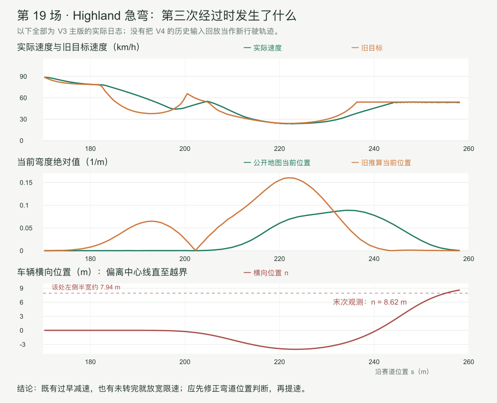

# 第 19 场日志分析：弯道慢、出弯加速弱与损坏退赛

分析日期：2026-11-17。数据来自用户本人第 19 文件夹中的 training JSONL、公开事件和公开 Highland 地图；没有把其他车的完整遥测当作已知数据。

## 结论

本场最严重的问题是弯道位置判断和方向控制失配。V2 加入、V3 主版保留的“前方 15/30 米弯度线性外推”在 Highland 发卡弯明显失真；方向控制又直接使用前方 15 米弯度。结果是直道上过早转向和减速，弯中反复加减速，出弯前过早放宽限速。本车第三次经过同一弯道时越界，随后因 damage 退赛。这是现有代码的问题，上一轮交通修复没有覆盖它。

直线方面，V3 上限就是 55 m/s，即 198 km/h；接近目标时，原来的纯速度误差油门没有补偿阻力和坡度。缓弯抓地预算也比较谨慎。但本场交通减速仅约 6.53 秒，不能把这次慢车主要归因于再次被前车堵住。

应优先修正“何时转、何时减速、何时加速”，再在稳定的缓弯和直线上提速。不能给所有弯道硬加固定油门。

## 数据核验与比赛结果

- job：`1688e1b3-89c6-4a12-a1cd-4e1492bc6e32`；本人席位 4。
- rules/kernel：`rsi-racing-4.4` / `rsi-formula-4.0`；赛道 Highland，坐标周期 6999.367 m。
- 20,192 次决策：排位 5,950、正赛 14,242；原始决策行字节数 66,923,087，导出 SHA256 为 `4e175529819839a650dcb3da0d10d563e4fcf83288ef928b47039d11619334d5`。结尾 `export_complete` 校验通过；头部 `complete:false` 不是日志损坏。
- 全部动作与冻结的 V3 主版一致，数值容差 0.000015；与独立 V3 弯道试验版有 1,460 帧差异。因此这场没有启用之前另给的弯道补油试验版。
- 没有程序 fault。bundle 的 `source_hash` 与单个 agent.py 文件哈希不是同一个概念。
- 排位第 6，有效计时圈 185.523 s；正赛最终第 7，`unclassified`，完成 2 圈后损坏退赛。
- 正赛在 474.733 s 结束本车决策；最末观测 s=258.100 m、累计 distance=14256.834 m。
- 本车最佳正赛圈 223.747 s，赢家最佳圈 172.534 s，相差 51.213 s，约 29.7%。不同车辆、交通和天气经历不同，这不是单一参数的因果实验。
- 发车湿度 1.0，事故前约 0.563；湿地因素确实影响速度。全场只有赢家跑完 4 圈，另有 2 车 running、7 车 unclassified，本车属于其中之一。

## 速度：不是从没接近 200，而是大量时间损失在弯道与恢复

以下是记录期间的按 30Hz 决策计数统计；弯道以公开中心线 `|curvature| >= 0.002 /m` 划分，并非官方弯道编号。正赛均值包括起步和事故前恢复，不是干净飞驰圈均值。排位统计包含计时圈之前的进场段。

| 指标 | 排位 | 正赛 |
|---|---:|---:|
| 实际最高速度 | 197.65 km/h | 196.87 km/h |
| 弯道平均速度 | 101.30 km/h | 81.66 km/h |
| 几何直道平均速度 | 167.27 km/h | 135.15 km/h |
| 正赛全段平均速度 | — | 108.23 km/h |
| 本人交通目标比道路目标低 >1m/s 的时长 | 0 s | 6.53 s |
| 前轮或后轮滑动标志出现时长 | 10.70 s | 110.43 s |

V3 正赛有约 89.73 秒的动作油门大于 95%，所以“整场都没给油”不成立。问题更集中在限速目标、控制时机、湿地滑动和偏离路线后的恢复。几何直道也可能在为前方弯道刹车，不能把直道均速全部当成发动机性能。

原油门公式是 `throttle = clip(0.25 * (target - speed), 0, 1)`。例如目标 198、实际 194.4 km/h 时油门约 25%；另一帧目标约 172.1、实际约 171.5 km/h，油门只有约 4.4%，而仅 drag+rolling 对应的维持油门约 18%。坡度、ERS 和瞬态还会改变实际加速度，这些例子证明原公式缺少维持速度所需的前馈，不能据此推算完整新圈速。

公开事件没有其他车辆逐帧完整速度；本人日志只记录视野附近对手。用户观察到的“其他车过弯快 20–30 km/h”有合理动机，但现有数据不足以给所有对手、所有弯做同条件差速排名。

## 损坏：这场能确定的是单车越界后的退赛



图中第三次经过该弯时，n 先偏向内侧约 −4 m，再冲向外侧超过 +8 m；虚线只是公开中心线左侧半宽，不是我们拟合的官方判罚边界。

| 正赛完成圈数 / s位置 | 实际速度 | 旧目标速度 | 横向位置n | 说明 |
|---|---:|---:|---:|---|
| 2圈 / 191.4m | 60.0 km/h | 38.5 km/h | 0.00m | 当前地图弯度约0.0001，但旧外推约0.0628，直道被当作急弯 |
| 2圈 / 224.4m | 24.0 km/h | 24.6 km/h | −4.02m | 过早转向后已偏内，旧外推弯度约0.154，真实约0.076 |
| 2圈 / 240.6m | 46.5 km/h | 54.0 km/h | +0.05m | 真实弯度仍约−0.075，旧外推却接近0，开始放宽速度；航向误差约0.57rad |
| 2圈 / 248.9m | 54.1 km/h | 54.0 km/h | +5.21m | 方向已打满，车辆继续冲向外侧 |
| 2圈 / 258.1m | 53.4 km/h | 54.0 km/h | +8.62m | 最后一次有效观测 |

公开事件对应：

- 第 27,903 行：`incident(reason=off_track, s=255.2416)`，比赛约 474.500 s。
- 第 27,916 行：`retired(reason=damage, lap=2)`，比赛约 474.733 s。
- 本人公开事件中未记录到车辆接触；事故附近本人 rival 列表也为空。

第一次正赛经过该弯时已偏外到约 3.4m，第二次约 6.4m，第三次超过 8.6m，说明相同控制缺陷在不同速度和天气下反复出现。这里不是轮胎磨损突然耗尽：末次最大磨损约 0.0884、燃油仍 57.39kg。

本场公开事件只显示本车 1 次 off_track 和 1 次 damage 退赛，并没有公开每个部件损伤的连续数值。滑动标志不能当作“损坏次数”；也不能从一场数据断言多次损伤全部由碰撞或悬挂参数造成。

## 对应修复与下一场验证

V4 使用公开地图的当前位置弯度、全圈制动约束和短时间方向提前量；缓弯、直线与稳定出弯更积极，急弯、打滑和靠近边界时保留保护。细节和测试见 [V4修改理由](V4修改理由.md)。

建议先上传单一 V4 候选，发布并确认报名版本已经切换；不把旧 V3 试验版混进同一次评估。下一场下载 training、公用事件和排名截图，优先检查：

1. 是否因 off_track/damage 退出，是否实际跑完 4 圈；`running` 或刚好达到分类门槛不等于跑完全部圈数。
2. Highland 约 208–258m 和 6561–6671m 两处急弯的 n、航向误差、滑动、油门/制动是否改善。
3. 其他两图的窄路、连续弯以及超车时是否仍保持余量。
4. 同地图、相近湿度下的干净圈速、弯道均速和直线加速；不要只看单个最高速度或班级名次。

只有正式平台产生的新行驶轨迹才能确认提速和完赛效果。现有工具包没有官方本地引擎，无法承诺多人比赛每场必定完赛。

复现：

```sh
python tools/analyze_race19.py --folder /path/to/Formula/19 --output analysis/race19
```

完整数值摘要和事故窗口逐帧数据分别保存在 `analysis/race19/diagnosis19.json`、`analysis/race19/hairpin19.csv`。原始日志未放入 Git 仓库或上传 ZIP。
